# Animal Island Cozy for Obsidian

溫暖紙張、柔和配色、緞帶文件名與圓角介面。以 **guokaigdg** 的 [Animal Island UI](https://guokaigdg.github.io/animal-island-ui/) 為設計基礎，由 Tiffany Iong 改編。

[安裝與自訂](#安裝與自訂) · [範例](#範例) · [待辦與提示框](#待辦與提示框) · [樣式圖鑑](#樣式圖鑑) · [日曆](#日曆) · [備註與致謝](#備註與致謝)

[English](README.md)


[開啟首圖示範筆記](examples/Welcome%20to%20Animal%20Island%20Cozy.md)

## 安裝與自訂

1. **設定 → 外觀 → 主題 → 管理**，搜尋並套用 **[Animal Island Cozy](https://community.obsidian.md/themes/animal-island-notes)**。
2. 安裝並啟用 **[Style Settings](https://community.obsidian.md/plugins/obsidian-style-settings)**（第三方插件）。
3. 開啟 **設定 → Style Settings → Animal Island Cozy**，調整外觀。

主題不依賴插件；Style Settings 提供自訂選項。首圖展示左側檔案欄、Properties、奶油紙張、彩色標題與表格；外觀可在 Style Settings 調整。

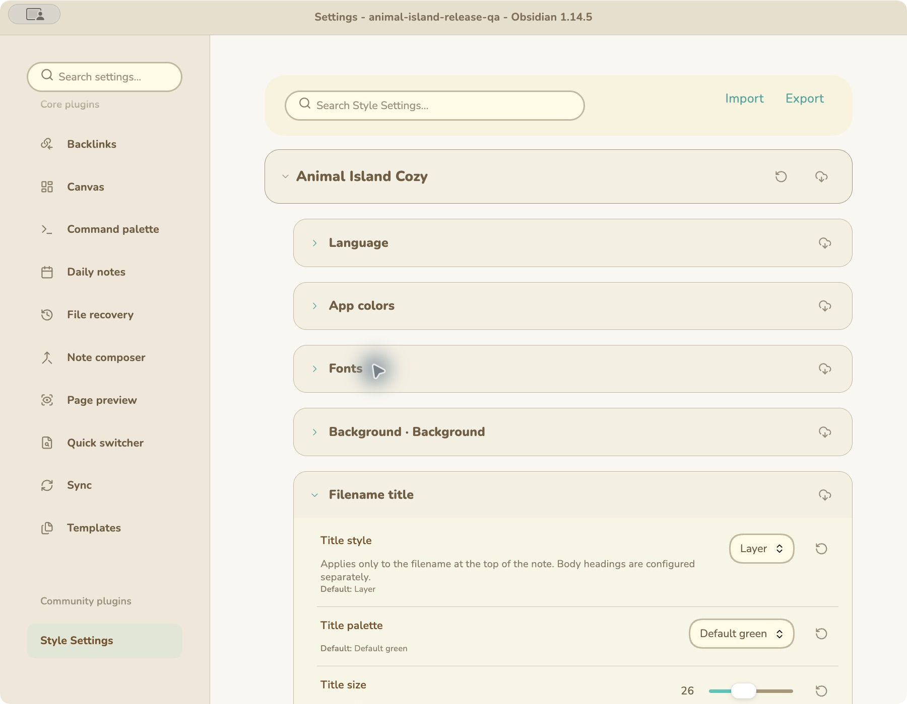

## 範例

[English Markdown](examples/Animal%20Island%20Example%20-%20English.md) · [繁體中文 Markdown](examples/Animal%20Island%20Example%20-%20中文.md) · [Download ZIP](https://github.com/tiffanyiong/obsidian-animal-island/releases/latest/download/animal-island-examples.zip)

ZIP 請保留目錄結構，以閱讀模式開啟。左英文、右繁中，皆為實際 Obsidian 截圖。

### 正文、文字效果與待辦

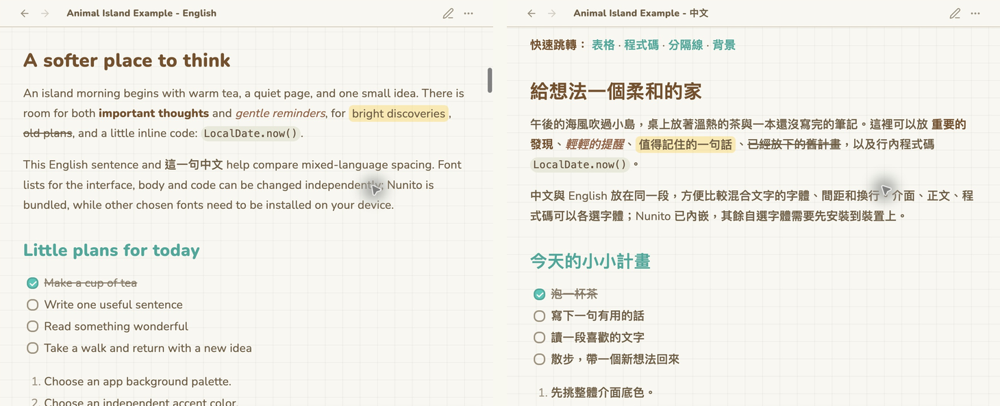

### 表格

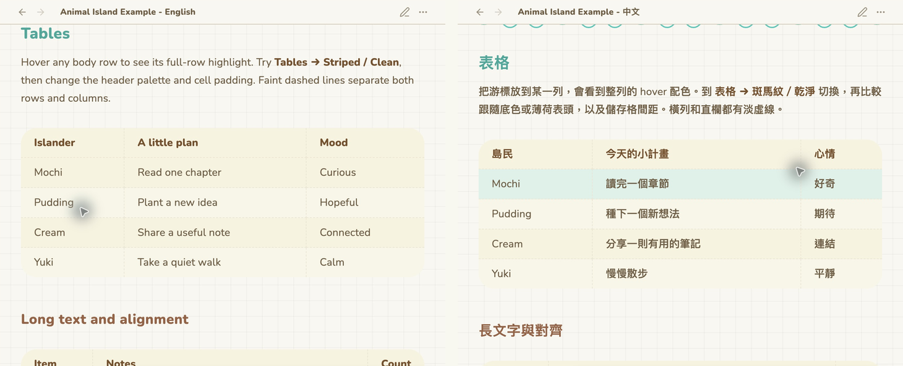

### Java 與 JSON

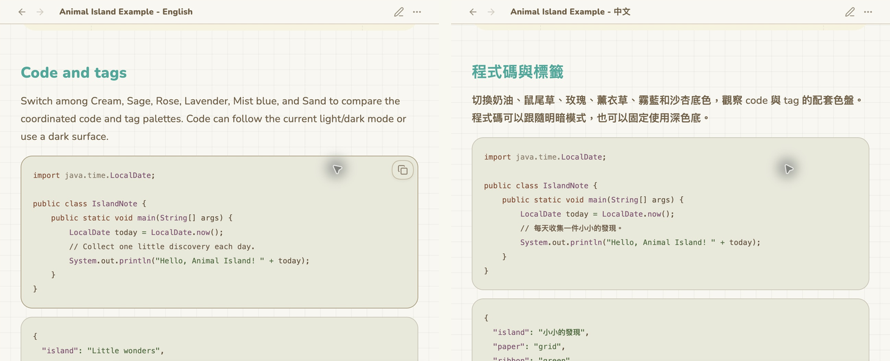

### 固定分隔線

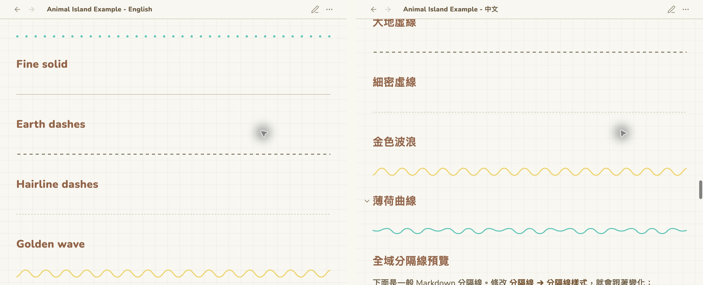

## 待辦與提示框

### Checkbox

**Images and tasks → Checkbox shape**：Rounded（圓角）／Circle（圓形）。**Checkbox border width**：0–3px，預設 2px。

```md
- [ ] Read a chapter
- [x] Write one useful note
```

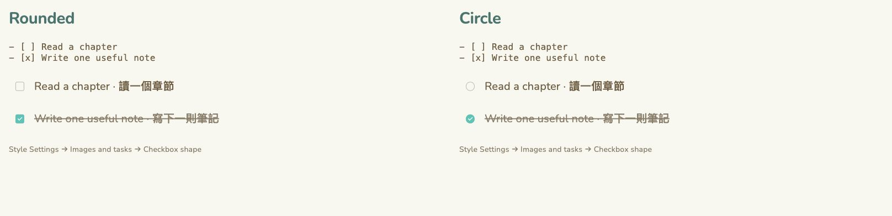

僅支援標準未完成／已完成造型；`[/]`、`[-]`、`[*]` 沒有專屬圖示。

### Callouts

```md
> [!tip] A little reminder
> Write one useful thought.
```

內建語法，不需插件。預設為彩色標題與圖示、1px 外框及 10% 背景不透明度；Warning 為黃色，Question 為橙色。

下方配色示例使用不透明度 0、外框 0；圖鑑展示不同設定組合，不一定是預設值。

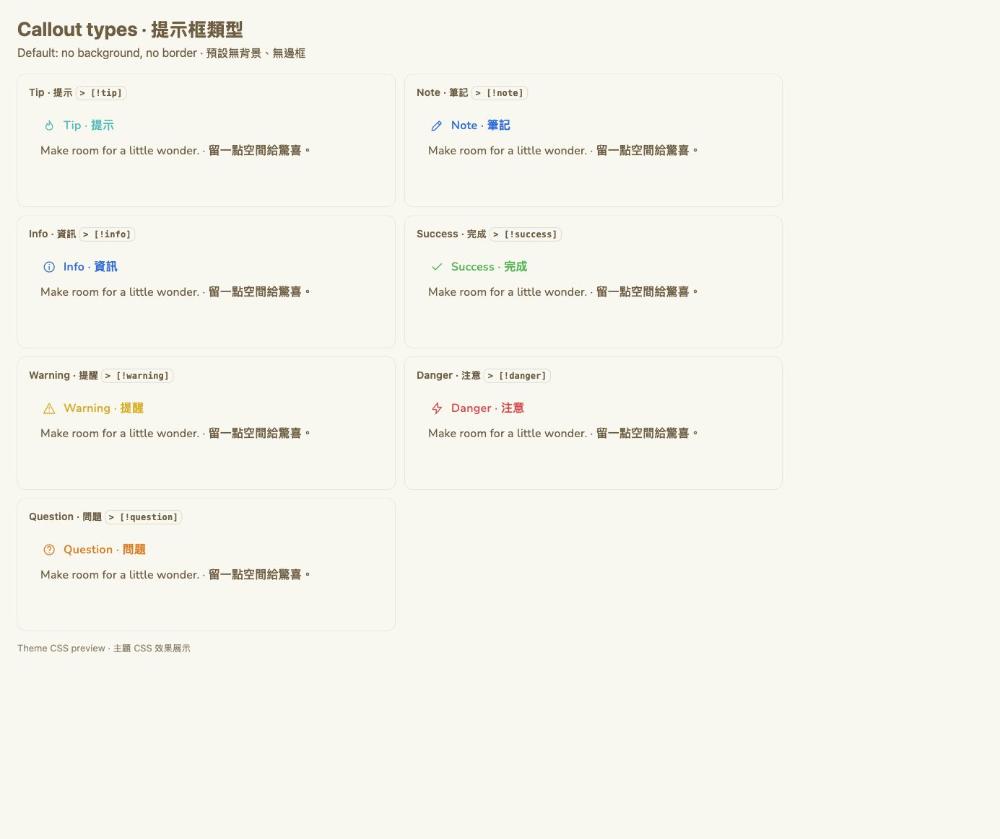

在 **Style Settings → Callouts and quotes** 調整：

- **Callout style**：Card／Side accent／Dashed。
- **Callout background opacity**：0–1，預設 0.1；0 為無背景。
- **Callout border width**：0–4px，預設 1px；側邊色條為設定值的兩倍寬。

下圖示範各種搭配；外框為 0 時，三種樣式都不顯示框線。

#### 樣式與設定值

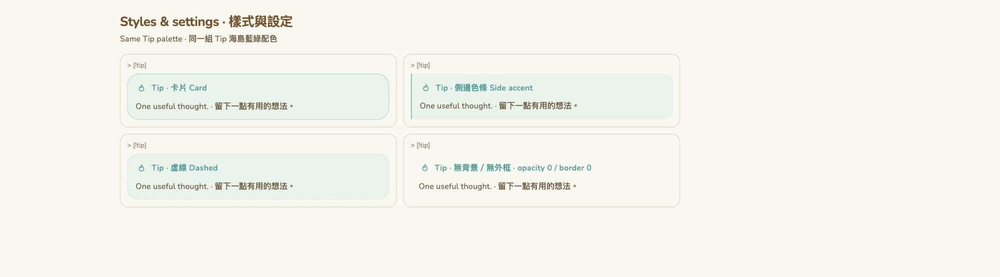

#### 全部配色 × 樣式

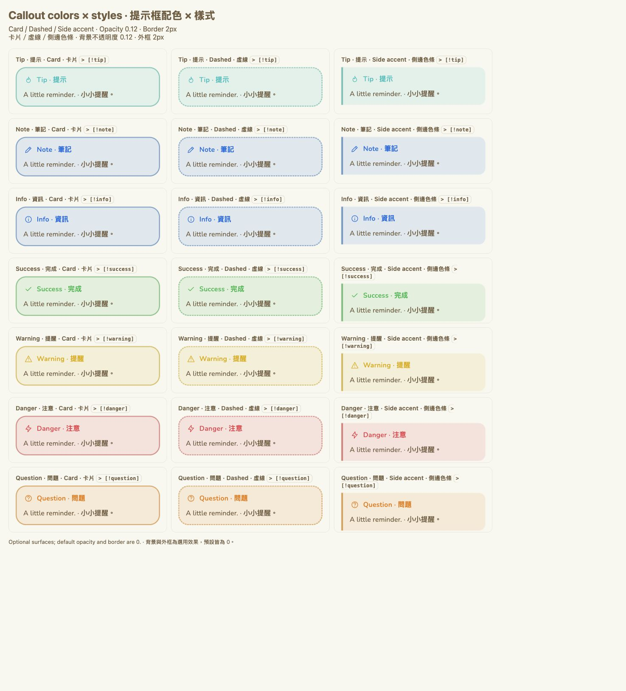

#### 可折疊 Question

`+` 預設展開，`-` 預設收合；點標題切換。其他 callout 類型也可使用相同語法。

```md
> [!question]+ A question / 一個問題
> Answer / 回答

> [!question]- More details / 更多細節
> Answer / 回答
```

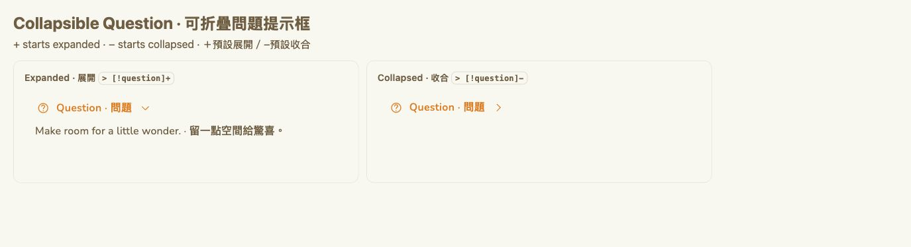


## 樣式圖鑑

### 整體配色、程式碼與標籤

**App colors → Interface background palette**：奶油、鼠尾草、玫瑰、薰衣草、霧藍、沙杏，或自訂色。


### 獨立主色

**App colors → App accent palette**：薄荷、粉紅、紫、藍、蜜桃、綠，或自訂色。


### 文件名造型

**Filename title → Title style**：雙層緞帶、緞帶、折角、純文字；正文標題另行設定。


### 文件名配色

**Filename title → Title palette**：13 組彩色與羊皮紙色，可獨立於介面配色。


### 紙張背景

**Background → Note background**：純色、奶油點、薄荷點、粉紅點、方格、彩屑；可調濃度與間距。


### 分隔線

**Dividers → Divider style**：六種造型。段落間獨立寫一行 `---` 即可使用。


### 表格

**Tables**：斑馬紋／乾淨、配套色／薄荷表頭、虛線格線、整列 hover，可調間距。


### 分頁與導覽

**Directory and tabs**：紙張／膠囊／底線分頁；柔和／薄荷／描邊選取效果。


### 屬性

**Properties**：卡片／虛線／平面。

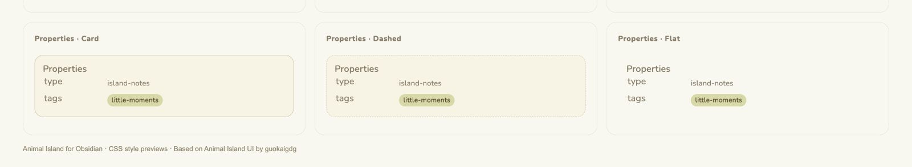

### 標籤與正文標題

**Tags**：實色／描邊／淡底。**Body headings**：純文字／底線／側邊色條。


### 控制項與待辦

**Controls**：膠囊／圓角、立體／平面按鈕。**Images and tasks**：圓角／圓形核取方塊。


### 引用、氣泡與字型

**Callouts and quotes → 引用背景不透明度**：0–1，預設 0.14；0 為無背景。**引用顏色**：14 種緞帶配色，可獨立選擇。

柔和氣泡；介面、正文與程式碼字型分開設定，Nunito 離線內建。


### 深色模式

**設定 → 外觀 → 基礎配色 → 深色。**


### 文字螢光標記

**Text highlight → Highlight color (ribbon palette)**：以 `==文字==` 標記，閱讀與編輯模式皆適用；提供緞帶相同的 14 色，預設黃色。 **螢光標記圓角**：0–6px，預設 6px；0 為直角。

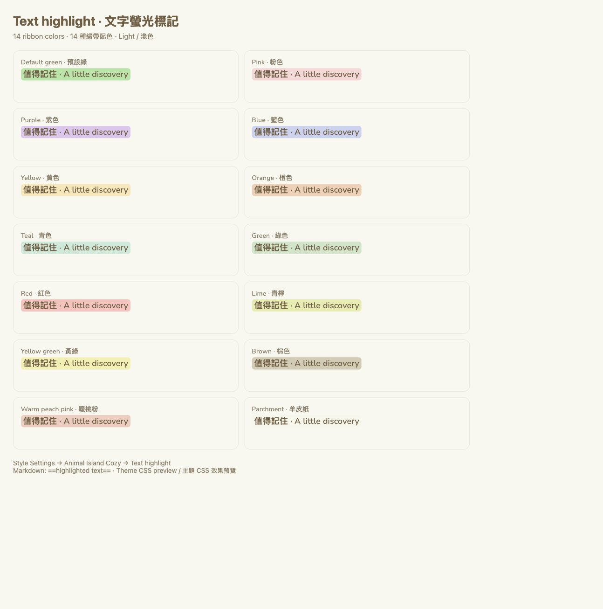


## 日曆

另行安裝 **[Animal Island Calendar](https://community.obsidian.md/plugins/animal-island-calendar)**，使用 Properties 日期／時間選擇器與獨立設定語言切換。它不是行程規劃工具。

屬性類型選 **Date** 或 **Date & time**。**Confirm** 儲存、**Clear** 暫存清空；Escape／關閉取消。改日期會保留時間。


## 備註與致謝

全部選項：[設定參考](docs/SETTINGS.en.md) · [中文樣式指南](docs/STYLE_GUIDE.zh-TW.md)。包含字級、正文寬度、行距、表格間距、圓角與動態效果；支援減少動態偏好。

手動安裝：將 [Releases](https://github.com/tiffanyiong/obsidian-animal-island/releases/latest) 的 `theme.css`、`manifest.json` 放入 `<vault>/.obsidian/themes/Animal Island Cozy/`。

測試環境：macOS／Obsidian 1.14.5；手機已有個別測試與使用者回饋，尚未全面跨平台驗證。無追蹤、外部服務或遠端字型。

原始設計：**[Animal Island UI by guokaigdg](https://guokaigdg.github.io/animal-island-ui/)**（[Source](https://github.com/guokaigdg/animal-island-ui) · [Skill](https://guokaigdg.github.io/animal-island-ui/#/skill)）。本主題為獨立改編。

[Release notes](RELEASE_NOTES.md) · [Issues](https://github.com/tiffanyiong/obsidian-animal-island/issues) · [MIT](LICENSE) · [Third-party notices](THIRD_PARTY_NOTICES.md) · [Nunito OFL](Nunito-OFL.txt)
